<h1 align="center">Armed</h1>

<p align="center"><strong>A third arm that autocompletes you.</strong></p>

<p align="center"><em>It watches the time, your room, your voice and your muscles, works out what you need, then acts, speaks, or checks with the people around you.</em></p>

<p align="center">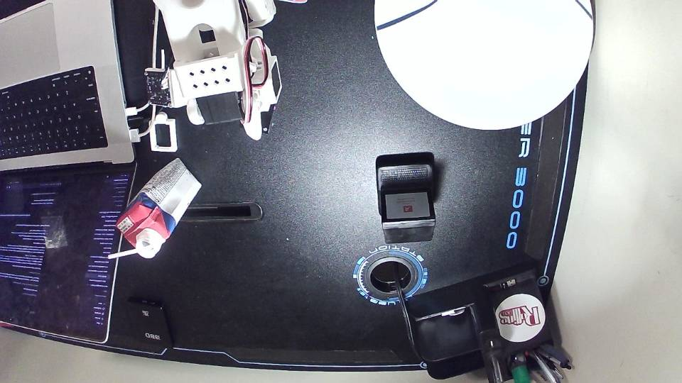</p>

<p align="center">
  <a href="#a-day-with-it">A day with it</a> ·
  <a href="#four-meta-models-each-where-only-it-fits">Meta models</a> ·
  <a href="#how-it-works">How it works</a> ·
  <a href="#from-brace-to-rule">Learning</a> ·
  <a href="#the-console">Console</a> ·
  <a href="#hardware">Hardware</a> ·
  <a href="#quick-start">Quick start</a>
</p>

---

Armed is a robot arm for a desk or a headboard that you almost never have to instruct. It reads the clock, the room, who is speaking and one muscle in your forearm, then proposes the thing you are about to need. A twitch says yes. A brace says no. If it gets something wrong while moving, that same brace freezes it with no model in the path. Then Muse Wonder studies the clip, writes one rule that can only make the arm more careful, and the next carry takes a different route.

Built in nine days by one person for the Meta Global AI Developer Hackathon, indie track, on an open-source SO-101 arm and a four-channel OpenBCI Ganglion. Four Meta models do the seeing, hearing, judging and investigating. Every motion is a taught pose.

> **Nothing a model says can move a motor.** Muse Spark proposes, Muse Wonder investigates, SAM 3.1 sees, Muse Voice Transcribe listens. Motion is taught poses only, behind a pure-function gate. The stop path has no model and no network in it. Joint values from a model: zero.

## A day with it

| | What happens | What you see on screen |
|---|---|---|
| **Phone** | The phone lights up while both hands are on the keyboard. Muse Spark sees the glow, a card asks *Bring the phone?*, one twitch, and the phone comes up to eye level. | The card, the inputs that made it, the muscle meter flashing once |
| **Shake** | Water time. There is no water on the desk, so it offers the protein shake instead and brings it to the mouth, straw first. | *It's shake time.* spoken by Spark from the routine and the scene |
| **Brace** | It carried the shake straight across the laptop. The forearm tenses, the arm freezes mid-air. No model in that loop. | The trace rising, the speed falling with it, the red *Stopped* edge |
| **Learn** | Muse Wonder replays the clip, tracks the shake with SAM 3.1, measures the laptop, and proposes one rule: keep liquids off the laptop. A checker proves the rule only removes options. | The tool loop line by line, two green ticks, the rule card |
| **Next carry** | Same request. The arm takes the close way round the laptop on its own. | The old route in red, the new one in green, *rule applied* |
| **Jar** | On a call, hands full. It sees the jar held out, offers to hold it, and the lid comes off mid-sentence. | *Hold the jar?*, the gripper load holding steady |
| **Bedside** | Same arm, clamped to the headboard. Someone else asks it to pass the marker; it waits for the wearer, then lands the marker in an open palm. | *X asked: marker*, the speaker label from Voice Transcribe, *Waiting for Pranay* |
| **Desk check** | Every half hour it looks at the desk. Rubbish goes in the bin after a five-second veto ring. The phone and the shake stay. | The ring counting down, the chain *1/2 · 2/2* |
| **Keys** | Standing up at the end of the day. *Your keys?* | The last card |

<table>
<tr>
<td width="33%">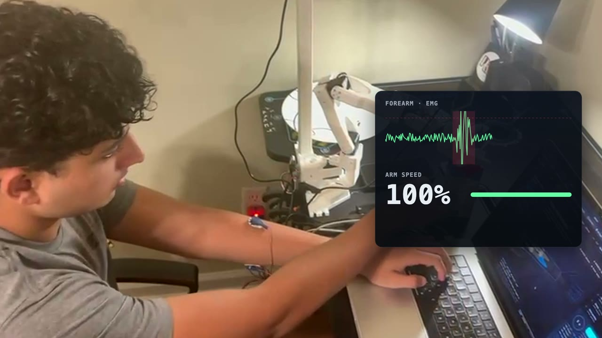<br><sub>The forearm trace and the arm's speed, side by side.</sub></td>
<td width="33%">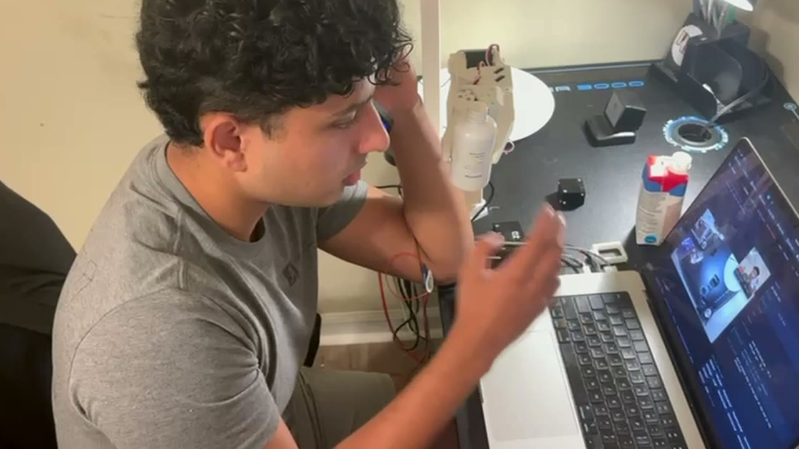<br><sub>On a call, hands full: the arm holds the jar.</sub></td>
<td width="33%">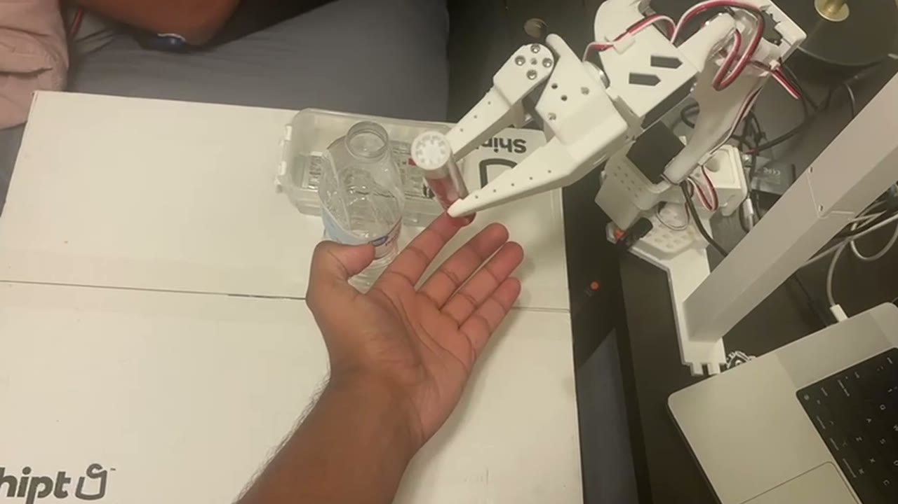<br><sub>The marker, into an open palm.</sub></td>
</tr>
</table>

Every yes in that day is one muscle. Words spoken to it: zero.

## Four Meta models, each where only it fits

<p align="center">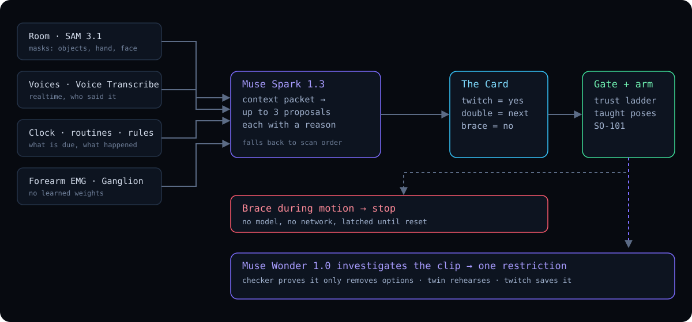</p>

| Model | Its job in Armed | Why this one |
|---|---|---|
| **Muse Spark 1.3** | The always-on judge. On every change in the room, and every 25 seconds otherwise, it reads the camera frame and the context packet and either stays silent, says one useful line, or proposes the single action you are about to need. It also ranks the cards. | Image in, tool calls out, a closed list of options so nothing it writes can reach a motor except an option id |
| **Muse Wonder 1.0** | The investigator. After a brace-stop it takes the incident clip, calls tools in a loop (track, measure, arm trace, body trace, propose_rule) and proposes one restriction in a rule language that has no word for *allow*. It can tell the next person who asks why the arm did what it did. | Video input, parallel tool calls, the whole day in context |
| **SAM 3.1** | The eyes and the ruler. Phrase-prompted masks of every object, the hand and the face on scene change, on events and on a ten-second cadence. The same masks track the shake across the clip and measure the miss in centimetres. | Phrase to pixel-accurate mask, tracked across frames |
| **Muse Voice Transcribe 1.0** | The ears that know who is talking. Realtime, with speaker labels, so a request from another voice becomes a card that waits for the wearer. Anyone can say *stand down*; only the wearer can arm it. | Diarization inside a streaming transcriber |

**On the demo day, from the event log** (`data/sessions/`, 16 sessions on November 4):

| | Calls | Median | p95 |
|---|---|---|---|
| SAM 3.1 scans of the desk | 435 | 1.85 s | 2.73 s |
| Muse Spark 1.3 thinking turns | 497 | 3.97 s | 7.62 s |
| Muse Voice Transcribe utterances | 373 | | |
| Muse Wonder 1.0 investigation of the laptop near-miss | 1 investigation, 12 tool calls in 7 turns | 46.5 s | |

Things Spark said that day, unprompted, from the scene: *"It's shake time."* · *"Desk check due."* · *"Slot two, screen up, got it."* · *"I'd bring the phone, but I can't prove my gripper is empty, and that move opens it."* · *"Pranay braced when I carried drink over laptop."*

Not used, on purpose: no learned motion policy. Meta offers no motor policy on the API, and a taught pick repeats on camera. The intelligence is in what to do and whether to do it, not in how to move.

## How it works

```text
 room ──► SAM 3.1 (phrase → masks: objects, hand, face; on change, events, 10 s) ─┐
 voices ─► Muse Voice Transcribe (realtime, speaker labels) ─────────────────────┼─► context packet
 clock, routines, history, rules ────────────────────────────────────────────────┤
 forearm EMG ─► Armed decoder (filters, RMS, thresholds; no weights) ─► twitch / brace / effort
                                                                                  │
                        Muse Spark 1.3: judges the packet; proposes or ranks ≤3 cards
                                                                                  │
                      the Card: proposal + the inputs that made it + the muscle meter
                                                                                  │
                      twitch = accept · double twitch = next · brace = refuse
                                                                                  │
                 Armed gate (pure function): trust ladder, consent by name, rules, reachability
                                                                                  │
                 Armed executor: taught poses only, speed coupled to muscle level ─► SO-101
                                                                                  │
   brace during motion ─► Armed stop controller (no model, no network) ─► freeze, latched
                                                                                  │
   incident clip ─► Muse Wonder 1.0 with tools (track, measure, propose_rule) ─► one restriction
                                                                                  │
   Armed checker: removes options only ✓ · replay: incident prevented ✓ · twin rehearses ─► card ─► twitch ─► rule memory
```

### One muscle, five meanings

Four electrodes on the forearm, a notch filter, a band-pass, RMS, a per-user calibration and threshold and onset rules. Signal processing, no learned weights. One channel yields five meanings by timing and context:

| Signal | Meaning |
|---|---|
| Twitch | Yes. Select the highlighted card; a second twitch confirms anything that moves |
| Double twitch | Next card, or send |
| Brace, arm still | No. The card drops and is not re-proposed for half an hour; refused twice in a day, it becomes a *don't propose that* rule |
| Brace, arm moving | Freeze. Latched until reset, then Wonder investigates |
| Sustained effort | Speed. The carry slows as the forearm tenses, before the brace threshold |

### The trust ladder

<p align="center">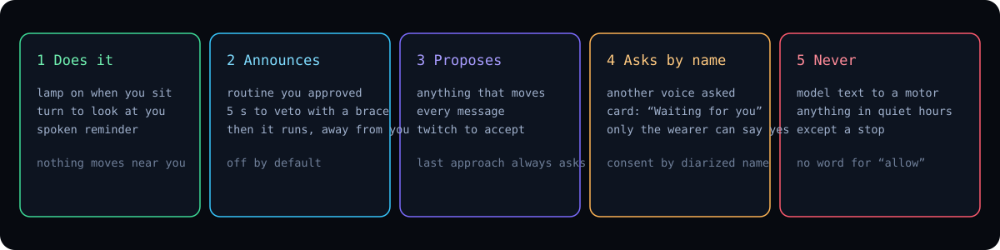</p>

Enforced in one pure function, never by the model:

- **Does it:** a lamp when you sit down, turning to look at you, a spoken reminder.
- **Announces, then does it:** a routine you pre-approved, away from your body. *Checking the desk*, a five-second veto ring, then it runs.
- **Proposes:** everything else that moves, every message. The final approach to your mouth or your hand always waits for a twitch, even inside a routine.
- **Asks the named person:** anything another voice requested.
- **Never:** model text to a motor or to a stranger; anything in quiet hours but a stop.

Routines are yours: a YAML list (`configs/routines.yaml`) edited on the console or by voice. Spark may suggest one new routine a day from what it has seen; only you can move anything up the ladder.

### What runs where

| Component | What it is | Meta / conventional |
|---|---|---|
| Objects, hand, face: masks, tracking, measurement | SAM 3.1, Meta Model API | **Meta** |
| Speech to text with speaker labels | Muse Voice Transcribe 1.0, realtime socket | **Meta** |
| Judging the room, proposing, ranking cards, the embodied tool loop | Muse Spark 1.3 | **Meta** |
| Incident investigation, rule proposals, *why* answers | Muse Wonder 1.0 | **Meta** |
| EMG decoder (`armed/sensors/emg.py`) | signal processing, no learned weights | conventional |
| Ranker fallback, safety gate, rule checker, route chooser, scene diff | code | conventional |
| Executor, taught poses, LeRobot driver | robotics software | conventional |
| Console, the Card, the 3D twin, the desktop shell | Three.js, vanilla JS, Electron | conventional |
| Learned motion policy | none | none |

Dependencies are only numpy, scipy, pyyaml, fastapi, uvicorn, httpx and opencv, plus `brainflow` for the band, `sounddevice` and `websockets` for the microphone stream and `lerobot[feetech]` for the arm. No local vision or speech model is installed.

## From brace to rule

<p align="center">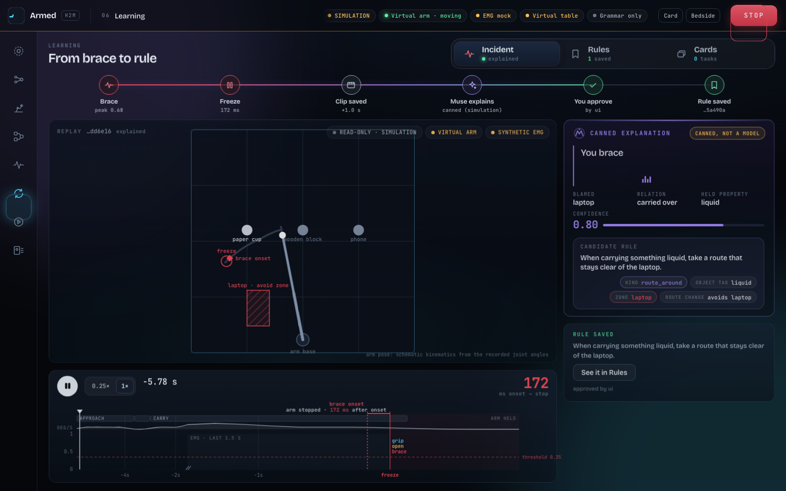</p>

1. **The brace freezes the arm.** The decoder's onset rule writes the stop straight to the servo bus. The six seconds before the freeze, at five frames a second with joints, contract and EMG, are already in a ring buffer.
2. **Wonder investigates.** It gets the clip and six tools. `track` asks SAM 3.1 to follow a phrase across the frames; `measure` turns two masks and a time into centimetres through the calibrated table; `arm_trace` and `body_trace` give it the joint path and the hand; `propose_rule` is the only way out.
3. **The rule language cannot say *allow*.** Four verbs: forbid, slow, lift, loosen. The proposal names what was held, what to avoid, and the response.
4. **The checker proves it.** A rule is accepted only if the set of permitted actions after it is a subset of the set before, and only if replaying the incident under the rule prevents it. The 3D twin rehearses the new route beside the frozen real arm.
5. **You approve it with a twitch.** It lands in `data/rules/`, applies to every object with the same tag, and the arm can state it to whoever asks.

The rule from the demo day, as saved:

```json
{"when_holding": ["liquid"], "avoid": "laptop", "response": "lift_higher",
 "incident_id": "20261104-164845-f1ae28", "approved": true, "id": "r510b3415"}
```

A refusal uses the same machinery: brace the same card twice in a day and *don't propose that* is offered as a rule.

## The console

| | |
|---|---|
| 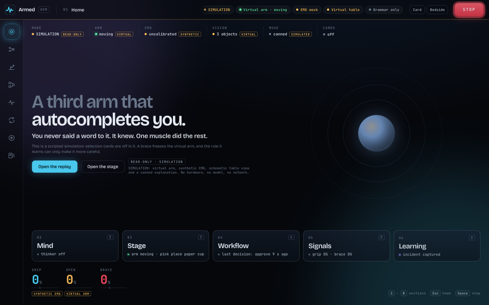<br>**Home.** The product page: the three sentences, the ladder, live status chips. | 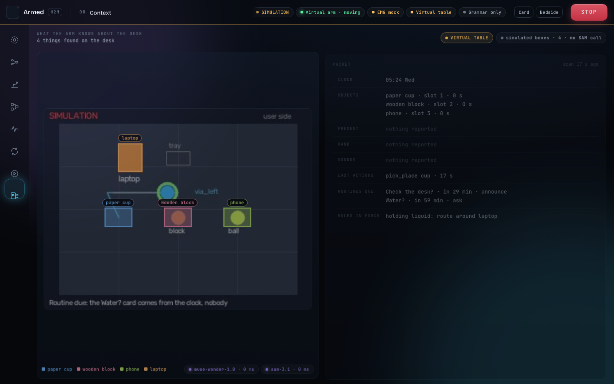<br>**Context.** What Muse is told: the raw frame with SAM masks painting in, then the packet: clock, objects with the age of their scan, who is present, the hand, sounds, history, routines. |
| 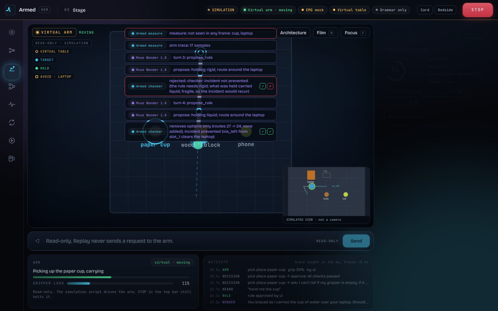<br>**Stage.** The Card, the muscle meter, the arm with its speed readout, the 3D twin, the route overlay. Film mode hides the chrome. | <br>**Learning.** From brace to rule: the clip, the timeline, the tool loop, the checker, the saved rules. |
| 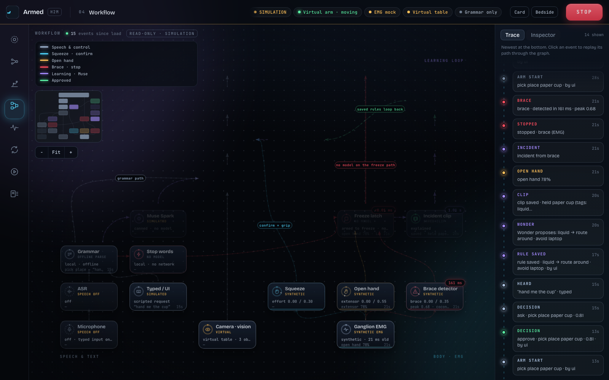<br>**Workflow.** Every decision with the checks it passed, and the day's call counts per model. | 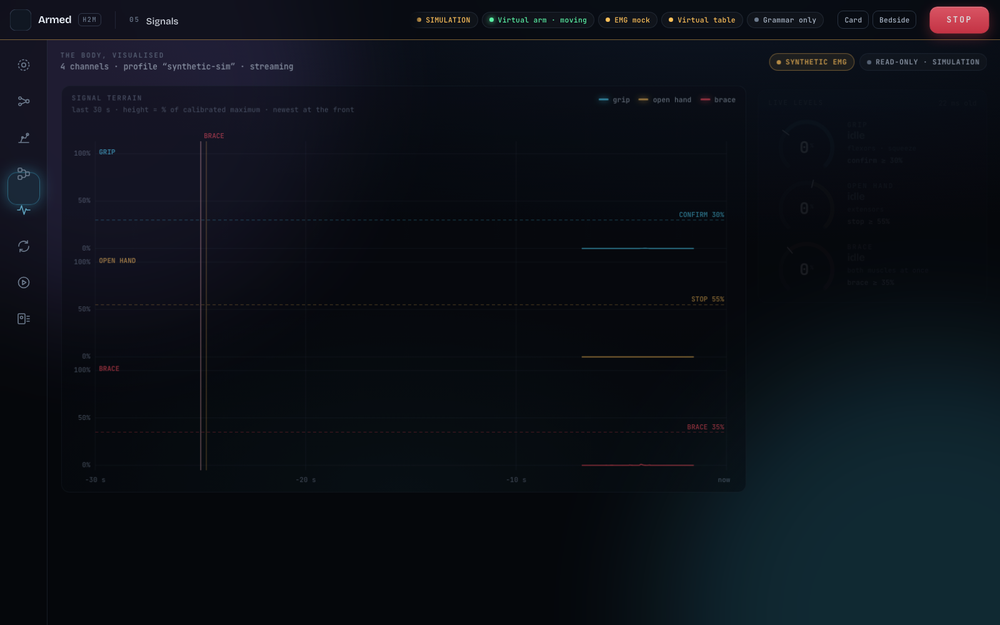<br>**Signals.** The four forearm channels, thresholds, calibration, every twitch and brace. |

<p align="center">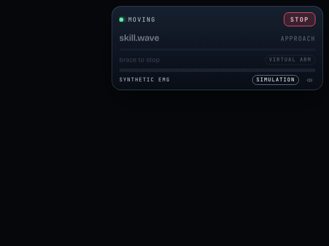<br><sub>The Card: the proposal, the inputs that made it, the muscle meter, and a STOP that never leaves the screen.</sub></p>

**Mind** is the view the film cuts to: senses on the left, what it knows, Spark thinking, what it says and suggests, the gate, the one confirmation and the arm, with the brace lane underneath. A node glows only while its model call is really in flight; a dot travels a connection only when a runtime event crossed it; violet is a Meta model, grey is Armed's own code, red is the stop path.

**The Card** also lives outside the browser: an Electron shell floats it over whatever you are doing, always on top, never focusable, click-through everywhere except STOP ([desktop/](desktop/README.md)). On the headboard it runs in far mode: one big card and a wide muscle band, readable from a pillow.

## Hardware

<p align="center">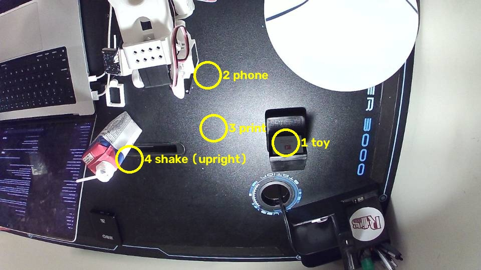<br><sub>The desk from the robot's own camera. Four taught slots; SAM 3.1 finds what is on them by phrase.</sub></p>

| Part | Role | List price |
|---|---|---|
| SO-101 follower arm, six STS3215 servos, printed frame | the arm, clamped to the desk or the headboard | about $120 to $230 as a kit |
| OpenBCI Ganglion, four channels, snap electrodes | the forearm signal | $499 plus about $40 of electrodes |
| Two USB webcams | overhead scene, wrist | about $60 |
| A laptop | runs everything, talks to the Meta Model API | |

About $700 of open hardware. 31 taught poses across the desk and the bed profiles; every skill in `configs/skills.yaml` is a sequence of them.

## Quick start

Software demo, no arm, no key: a scripted scenario on the virtual arm.

```bash
uv venv --python 3.12 && uv pip install -e ".[dev]"
```

```bash
.venv/bin/armed demo
```

Open http://127.0.0.1:8080. With the Meta Model API key in a git-ignored `.env` as `MODEL_API_KEY`, check it with one call:

```bash
.venv/bin/armed muse-check
```

The full live runtime on the SO-101 and the Ganglion, with every Meta model live (needs `.[emg,arm]`, taught poses and the hardware e-stop within reach; it refuses to start without the flag):

```bash
.venv/bin/armed run --profile live --i-have-the-estop
```

`--profile live,bed` switches to the headboard profile. The arm starts disarmed; say *arm yourself*, then *yes*. Bring-up of the arm, cameras and calibration: [docs/hardware](docs/hardware/README.md). How the live runtime behaves, what Spark sees and may do, and the measured latencies: [docs/LIVE_RUNTIME.md](docs/LIVE_RUNTIME.md).

Tests: `.venv/bin/python -m pytest -q`.

## Repository map

```text
armed/          runtime: contract, gate, selection, rules, EMG decoder, executor, Muse clients
web/            console and the Card (no build step; Three.js vendored)
desktop/        Electron shell for the Card
configs/        armed.yaml (every threshold), poses, skills, routes, routines, profiles
docs/           design, proactive behaviour, interface, live runtime, APIs, hardware
scripts/        bring-up, calibration, camera and motor checks
tests/          900+ tests
```

- The design: [docs/ARMED_IDEA.md](docs/ARMED_IDEA.md)
- Proactive behaviour and routines: [docs/PROACTIVE.md](docs/PROACTIVE.md)
- The interface: [docs/UI.md](docs/UI.md)
- The live runtime and Spark's manners: [docs/LIVE_RUNTIME.md](docs/LIVE_RUNTIME.md)
- APIs: [selection](docs/SELECTION_API.md), [replay](docs/REPLAY_API.md), [local API rules](docs/LOCAL_API.md)

## Built during the event

Everything in this repository was written between October 26 and November 4, 2026, by one person, working with AI coding agents. The dated commit list is [docs/BUILT_DURING_EVENT.md](docs/BUILT_DURING_EVENT.md).

**Builds on, and credits:** VLM intent inference with a confirm key (CASPER, CoRL 2025); EMG-controlled assistive arms (DLR EDAN); ranked next-action menus (Naughton & Hauser, RA-L 2022); interface-aware shared control (Argall's lab); supernumerary-limb research. **Reused:** the SO-101 design and LeRobot's driver and calibration (Hugging Face, TheRobotStudio); OpenBCI's Ganglion and BrainFlow; Three.js; Electron. **Models:** Muse Spark 1.3, Muse Wonder 1.0, SAM 3.1 and Muse Voice Transcribe 1.0 through the Meta Model API.
